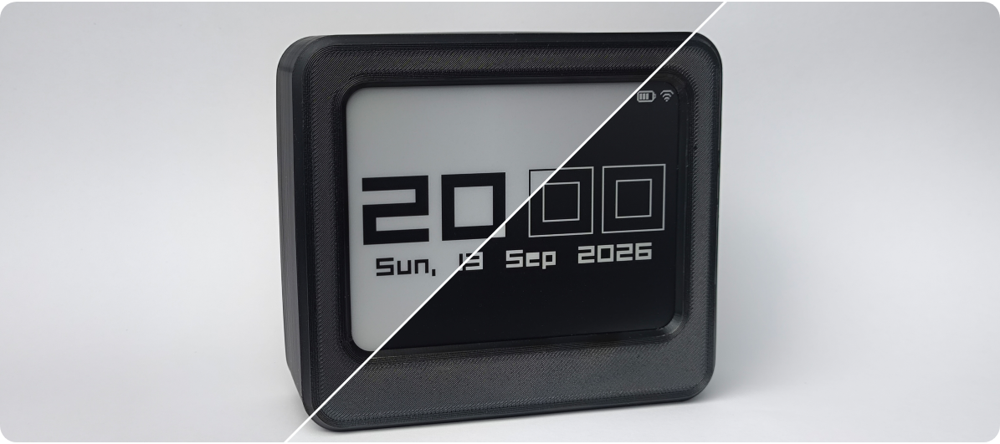
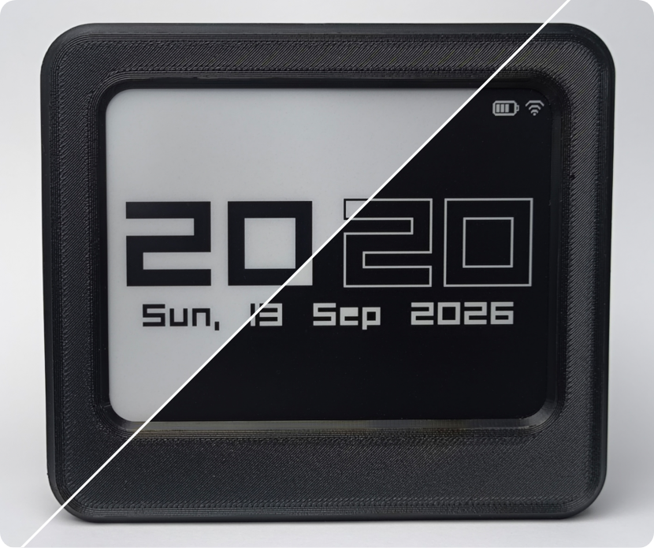
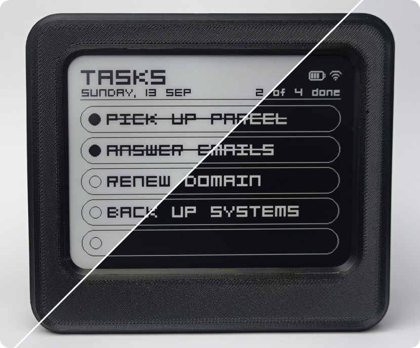
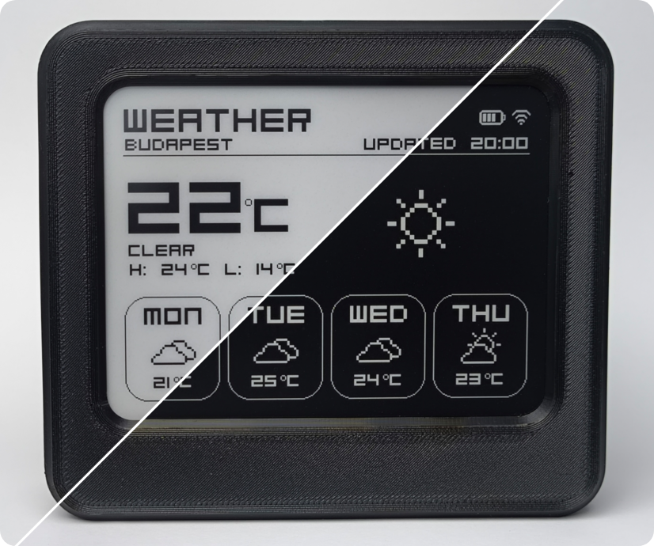
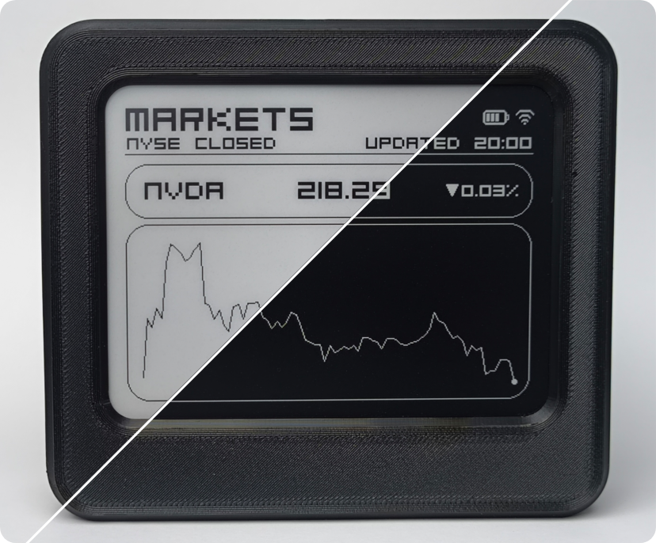
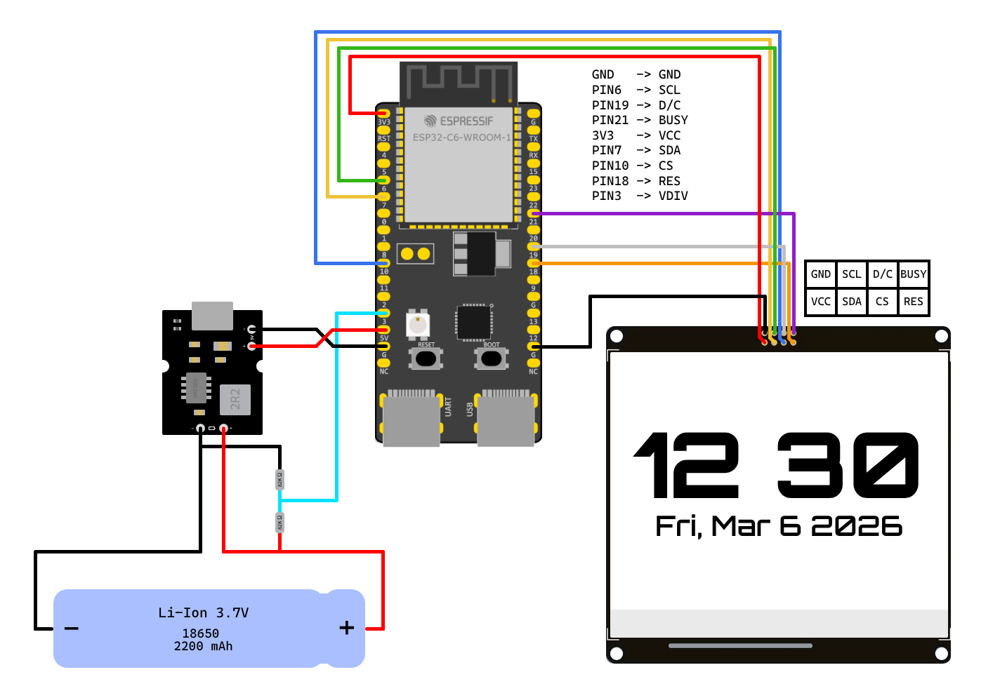
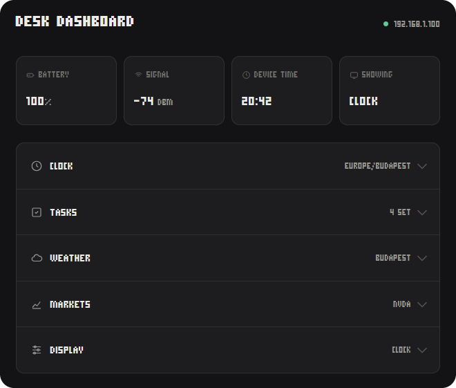

# E-ink Desk Dashboard

A standalone e-ink desk display with a 4.2-inch screen and a rechargeable battery. It cycles through a clock, a task list, the local forecast, and a stock quote. An ESP32-C6 serves a settings page over Wi-Fi, where you can edit tasks, change the rotation interval, or pin one screen.

<table align="center" width="800">
  <tr>
    <td colspan="2"></td>
  </tr>
  <tr>
    <td width="50%"><br>Clock with an optional date line</td>
    <td width="50%"><br>Tasks with a count of finished items</td>
  </tr>
  <tr>
    <td><br>Today's weather and a four-day forecast</td>
    <td><br>Stock quote and recent price chart</td>
  </tr>
</table>

## Parts and wiring

The parts for this build cost about €30, including the enclosure.

| Part | Details |
| --- | --- |
| ESP32-C6-DevKitC-1 | Board with 8 MB of flash |
| WeAct 4.2-inch e-ink panel | 400 × 300, black and white, SSD1683 controller |
| SM5308 power module | USB-C charging and 5 V boost output |
| 18650 Li-ion cell | 2200 mAh |
| Two 82 kΩ resistors | Voltage divider for the battery reading on GPIO 3 |
| 3D-printed enclosure | The [body](enclosure/enclosure_body.stl) and [screen frame](enclosure/enclosure_screen.stl) print separately |

The firmware uses the pins in the diagram. If you use another C6 board, check its pinout against [config.h](src/config.h) and its flash size against [platformio.ini](platformio.ini).

<p align="center"></p>

<p align="center"></p>

## Flash and set up

1. Install the pioarduino IDE extension for VS Code or follow the [pioarduino CLI installation instructions](https://github.com/pioarduino/platform-espressif32#installation). Then clone the project and copy the Wi-Fi template.

   ```sh
   git clone https://github.com/sidereall/eink-desk-dashboard
   cd eink-desk-dashboard
   cp src/secrets.h.example src/secrets.h
   ```

2. Set `WIFI_SSID` and `WIFI_PASSWORD` in `src/secrets.h`. Changing networks takes another firmware upload. Connect the board over USB and run both commands from the project directory.

   ```sh
   pio run -t upload      # firmware
   pio run -t uploadfs    # settings page and font
   ```

   If the page says `index.html missing from filesystem`, run `pio run -t uploadfs`.

3. On first boot, the Info screen shows the IP address once Wi-Fi connects. Open that address in a browser on the same network. Tap BOOT or choose Dismiss info screen on the page to start the dashboard. Later boots skip Info once you've dismissed it.

4. Choose your time zone and search for a city for the Open-Meteo forecast. For stock quotes, enter a Twelve Data API key. The default symbol is SPY. You can search for a US stock or ETF by name or ticker. Each section saves separately.

5. On the settings page, open Display to change the rotation interval (five minutes by default), pin a screen, or switch the panel to dark mode.

6. To clear saved settings and tasks, hold BOOT for three seconds. The dashboard returns to the Info screen.

<p align="center"></p>
